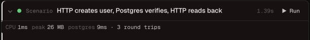
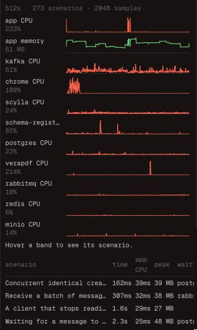

# Profile

While the scenarios run, tomato measures the application under test and the
containers it depends on, and reports what each scenario cost: not only
whether it passed, but how much CPU and memory it took, which dependency the
app waited on, and whether the app logged errors along the way.

Everything is measured from outside the application. Nothing in its code or
its build changes: tomato reads the processes it started, the containers it
runs, and the traffic through the [network](network.md) resources' proxies.

It is on by default. To turn it off:

```yaml
settings:
  profile: false
```

## What a scenario's profile says

| Figure | Where it comes from | How exact |
|--------|---------------------|-----------|
| app CPU | the app's processes: its process group in command mode, so `go run` or `npm start` counts the server they start; its container in container mode | exact: the process's CPU counters at the scenario's start and end |
| app memory: peak, start, end | the same processes' resident memory | sampled four times a second, so a very short spike between samples is missed |
| open files and threads, at start and end | the same processes | exact at the edges |
| each container's CPU and peak memory | Docker's stats | to within the second Docker reports at |
| per dependency: connections, still open, bytes each way, round trips, time waited | the [network](network.md) resource in front of it, when there is one | exact; the time is the dependency's own, not latency a scenario adds |
| errors and warnings the app logged | the app's output, by the level its log lines carry | see below |

A scenario's window opens after tomato resets the resources and runs the
`before_scenario` hooks, so truncating tables or recreating topics is not
counted to it, and closes when its last step ends.

**Time waited** is from each request the app sends to the first byte of the
dependency's answer, summed over connections. For a client that long-polls,
like a Kafka consumer waiting for messages, it includes the time the broker
held the request open.

**Logged errors** are lines with an error level in the common formats: a word
like `ERROR` or `FATAL`, logfmt's `level=error`, or JSON's
`"level":"error"` (also `severity` and `lvl`). A line that only mentions the
word, like `GET /errors 200`, does not count. Lines the app logs between
scenarios, at startup for example, count toward none.

## In the terminal

After the results, tomato prints the scenarios that cost the app the most
CPU, the ones that made it log errors, and what kept growing over the run:

```
Profile
  scenario                                        time  app CPU  peak mem    Δ mem  waiting on
  burns CPU                                      404ms    390ms     33 MB   +40 KB
  holds memory                                    85ms     79ms    129 MB   +97 MB
  logs an error                                    3ms      0ms    130 MB   +80 KB
  does nothing much                                3ms      0ms    130 MB     +0 B

  The app logged errors in 1 scenario:
    logs an error: 1 error
  The app's memory grew by 97 MB over the run (33 MB → 130 MB).
  full profile: .tomato/runs/2026-10-22_031924_ff279203/profile.json
```

What grows over the whole run is the useful signal for a leak: one
scenario's memory or connections are often still held by a pool or a cache
when it ends, but a number that climbs from the first scenario to the last
does not come back. tomato points out memory that grew by more than 64 MB,
open files that grew by more than 50, and connections to a dependency that
grew by more than 10.

## In `tomato ui`

Each scenario's card shows what it cost, with a small chart of the app's CPU
and memory while it ran. The inspector's **Profile** tab draws the whole run
as a timeline, a lane each for the app's CPU and memory and every container's
CPU, with the scenarios as bands across them, and lists the scenarios that
cost the app the most.





## In the run directory

Every run writes `profile.json` next to its logs in `.tomato/runs/`: every
scenario's profile, in the order they ran, and every sample. The `tomato`
event format carries the same, as it happens; see
[the `tomato` event format](index.md#the-tomato-event-format).

## Read it as a profile, not a benchmark

- The figures come from the machine the suite runs on, next to its
  containers, so they compare scenarios with each other and runs with
  runs, not your laptop with production.
- The first scenarios pay for warm-up: a JIT compiling, caches filling,
  connections opening. Startup itself is before the first scenario and
  counted to none.
- Scenarios have to run one at a time for a scenario's figures to be its
  own, so profiling is off when `parallel` is above 1.
- A process the app starts and that exits takes its CPU counters with it, so
  a scenario that runs a short-lived child process is under-counted by what
  the child used.
