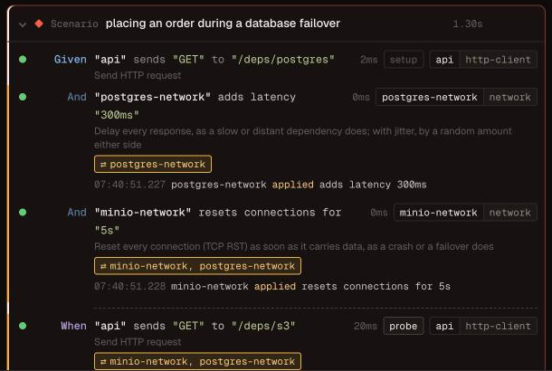
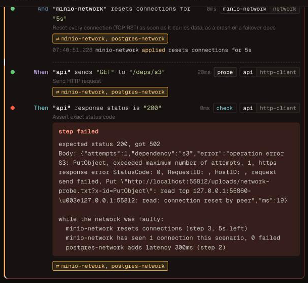

# Design: network faults

Status: proposal, with a proof of concept on `feat/network-faults`.

A `network` resource puts a proxy between the application under test and one
of its dependency containers, so a scenario can make that dependency slow,
cut its connections, make it hang or refuse connections, and then check what
the application does. It works the same way for every dependency tomato runs
in a container, because it works on TCP: Postgres, MySQL-compatible
databases, Redis, Kafka, RabbitMQ, ScyllaDB, MinIO and anything else.

This page has three parts: what a spike found, the interface users write, and
what the reports show.

## Why

Production fails in ways a healthy test environment never does: a database
that answers in 800 ms, a broker that drops every connection during a
failover, a cache that accepts a connection and never answers. tomato can
already stop and pause containers (`lifecycle`) and make its own HTTP and gRPC
stubs slow or unreachable. What it cannot do is degrade a real dependency
without taking it down, and only for the application: the faults must not
reach the steps that check the result.

## Spike

The spike embedded [Toxiproxy](https://github.com/Shopify/toxiproxy) v2.13.0
in a Go process, in front of real containers, and drove each one with the
client library tomato already uses, configured the way an application would
be. Each fault was applied to a pooled connection, then removed, and the
client's recovery timed.

| Fault | Postgres (lib/pq) | Redis (go-redis) | S3 (MinIO, aws-sdk-go-v2) | RabbitMQ (amqp091) | Kafka (sarama) |
|---|---|---|---|---|---|
| latency 300 ms | 302 ms | 302 ms | 312 ms | 302 ms | 304 ms |
| hang (`timeout` 0) | **client ignored its deadline, stayed blocked** | i/o timeout at 2 s | deadline exceeded | deadline exceeded | deadline exceeded |
| reset (`reset_peer`) | connection reset by peer | EOF | request failed | EOF | EOF |
| refuse (proxy disabled) | connection refused | connection refused | connection refused | connection refused | connection refused |
| fail the next 2 connections | 2 fail, 3rd ok, pool untouched | same | same | same | same |
| after the fault is removed | recovers in 1 try | 1 try | 1 try | **never: no reconnect** | 1 try |
| `packet_loss` 30 % | 5 of 10 fail | 3 of 10 | 4 of 10 | (connection already dead) | 7 of 10, "correlation ID didn't match" |

Two of those cells are the point of the feature: they are bugs an application
would ship. A service on lib/pq hangs for good when its database stops
answering, unless it sets a TCP or statement timeout; a service on amqp091
never recovers from a dropped connection unless it reconnects itself.

### Findings

1. **Embedding works.** `toxiproxy.NewServer`, `NewProxy`, `Proxy.Start` and
   `Stop`, and `Toxics.AddToxicJson` / `RemoveToxic` are exported and enough to
   run proxies in tomato's process without Toxiproxy's HTTP API. Its logging
   goes to a `zerolog.Nop()`.
2. **Go 1.27.** Toxiproxy v2.13.0 requires Go 1.27; v2.12.0 builds with 1.23
   but has no `packet_loss`. The proof of concept moves tomato to Go 1.27.
3. **Faults reach open connections.** Adding a toxic splices it into every
   live connection, so a fault applied in the middle of a scenario affects the
   application's pooled connections at once, which is what a scenario wants.
4. **A disabled proxy keeps its port.** `Stop` closes the listener and every
   open connection; `Start` listens on the same port again, so the
   application's configured address stays valid.
5. **Toxiproxy cannot count connections or fail only some of them
   reproducibly.** `toxicity` is rolled with Go's global, unseeded random
   source, and rolled again for every live connection whenever another toxic
   is added. So tomato adds one toxic of its own, the *gate*, installed when a
   proxy starts and before any connection exists. Toxiproxy creates a
   stateful toxic's state once per connection, when it opens, so the gate
   decides there whether the connection fails ("the next 2", or a seeded
   percentage) and counts it. The spike confirmed it on all five protocols:
   exactly the next two new connections failed, the pooled ones were
   untouched, and the same seed gives the same pattern.
6. **`ResetToxics` removes the gate too.** tomato removes its own faults by
   name instead.
7. **Unknown attributes are ignored silently.** `{"rate": 0.3}` instead of
   `{"loss_rate": 0.3}` gives a toxic that does nothing. tomato builds every
   toxic from typed values, never from user JSON.
8. **`packet_loss` drops chunks of the TCP stream, not IP packets.** TCP would
   retransmit a lost packet; this loses bytes the protocol expected, so the
   client sees a stall or a garbled stream. It is a useful fault, but not
   "packet loss", and the step says what it does.
9. **Kafka needs its listeners rearranged.** A Kafka client dials the
   bootstrap address once, then the address the broker advertises. With a
   proxy only in front of the bootstrap port, every fault after the first
   request was bypassed (the "naive" run: latency 5 ms, hang and reset had no
   effect). With the broker advertising the proxy's port, every fault worked,
   and a second listener advertising its own port gave tomato's kafka
   resource a direct path while the application's link hung (produce in
   8 ms). tomato already picks the broker's host ports before it starts, so
   the kafka preset can do both.
10. **Only the application goes through the proxy.** The application learns
    a dependency's address from `{{.postgres.port.5432}}` in `app.env`, while
    tomato's own resources ask the container manager. Pointing the template
    at the proxy keeps every assertion step on the direct path.

## Interface

### Configuration

One `network` resource per dependency container:

```yaml
containers:
  postgres:
    image: postgres:16-alpine
    ports: ["5432/tcp"]

app:
  command: ./orders
  env:
    DATABASE_URL: "postgres://test:test@{{.postgres.host}}:{{.postgres.port.5432}}/test"

resources:
  orders-db:
    type: postgres
    container: postgres

  postgres-network:
    type: network
    container: postgres      # the dependency the application reaches through it
    options:
      ports: [5432]          # default: every port the container exposes
      seed: 42               # default: random, printed at the start of the run
```

Nothing else changes. `{{.postgres.port.5432}}` now resolves to the proxy's
port, and `orders-db` still connects straight to the container. With the
kafka preset, the broker advertises the proxy to the application and a
direct listener to tomato's kafka resource.

### Steps

Every fault lasts until the scenario ends or the network is healed. Each one
also takes `for "<duration>"`, after which it heals by itself, which is what
retry and reconnect code has to survive.

| Step | On the wire | Looks to the application like |
|---|---|---|
| `"postgres-network" adds latency "300ms"` | delays every response | a slow dependency |
| `"postgres-network" adds latency "300ms" with jitter "100ms"` | random ±100 ms | an uneven one |
| `"minio-network" limits bandwidth to "64KB/s"` | throttles responses | a slow link |
| `"postgres-network" stops responding` | accepts, forwards nothing | a hung dependency, a partition |
| `"redis-network" resets connections` | TCP RST on every connection | a crash, a failover |
| `"kafka-network" refuses connections` | closes the listener and open connections | the dependency is down |
| `"postgres-network" fails the next "2" connections` | the next two new connections close at once | a dependency coming back up |
| `"postgres-network" fails "30%" of new connections` | seeded, per connection | an intermittently failing one |
| `"kafka-network" loses "30%" of the data` | drops chunks of the stream | a garbled or stalled link |
| `"rabbitmq-network" flaps every "2s"` | refuses, then accepts, in turn | a dependency restarting in a loop |
| `"postgres-network" is healthy` | clears every fault | |

and two to check what the application did about it:

| Step | Checks |
|---|---|
| `"postgres-network" has seen "3" connections` | new connections since the scenario started, so a retry or a reconnect is something to assert |
| `"rabbitmq-network" sees a new connection within "10s"` | the application reconnected |

Before every scenario the resource heals the network, resets its counts and
stops its timers, before any other resource resets, so postgres truncates and
kafka recreates topics over a healthy link.

```gherkin
Scenario: an order survives a database failover
  Given "postgres-network" resets connections for "3s"
  When "orders-client" sends "POST" to "/orders" with json:
    """
    {"id": "ord-1", "total": 1999}
    """
  Then "orders-client" response status is "201"
  And "postgres-network" has seen "2" connections
```

### Limits

- **Command mode only.** In container mode (`app.build`) the application
  reaches `postgres:5432` over the Docker network, past a proxy in tomato's
  process. A proxy container on that network is the follow-up.
- **TCP only, and blind to the protocol.** It cannot fail only the `INSERT`s
  or only one Kafka topic. For HTTP and gRPC dependencies, the `http-server`
  and `grpc-server` stubs already answer late or refuse connections, per
  request.
- **Kafka through the preset.** A hand-configured broker has to advertise the
  proxy itself.

## Reports

A fault nobody can see in the report makes a confusing failure, so each
surface says which faults were on, when, and what they did.

**At the start of the run**, next to the containers:

```
  ✓ postgres
  ⇄ postgres-network  app → 127.0.0.1:51726 → postgres:5432  (seed 42)
```

**On a failing step**, in every format, the error says which faults were
active and since which step, after the step's own error. The text is added by
the wrapper every step handler already goes through
(`internal/resource/stepdef.go`), and the error still unwraps to the step's
own, so the diff `tomato ui` draws for a failed comparison is unchanged:

```
expected status 200, got 502
while the network was faulty:
  minio-network resets connections (step 3, 5s left)
  minio-network has seen 1 connection this scenario, 0 failed
  postgres-network adds latency 300ms (step 2)
```

**In the `tomato` event stream**, which `tomato ui` reads, every `step_end`
carries the network events recorded while the step ran, with absolute
timestamps, and the faults that were active. A network resource records its
events the way the browser resource records screenshots
(`resource.RecordNetworkEvent`, drained by the formatter at the step's end);
events after the last step go on the `scenario_end`.

```json
{"type": "step_end", "step": "\"minio-network\" resets connections for \"5s\"",
 "status": "passed",
 "network": {
   "events": [{"at": "2026-10-21T07:32:07.068+02:00", "resource": "minio-network",
               "kind": "applied", "detail": "resets connections for 5s"}],
   "active": ["minio-network resets connections (step 3, 5s left)",
              "postgres-network adds latency 300ms (step 2)"]}}
```

The kinds are `applied`, `healed` (by the step, or when its duration ran
out), and `connection` (one the gate failed).

**In `tomato ui`**, a step that ran while a fault was on has a band and a
badge naming the networks, with the faults on hover; the step during which
something changed lists it with its time:





## Plan

1. The proof of concept, on `feat/network-faults`: the `network` resource with
   every fault above, `for` and healing, the connection count and wait, the
   kafka preset's listeners, the events and the failing-step summary in every
   report, and the steps marked in `tomato ui`. `tests/features/network.feature`
   runs each fault against Postgres, Redis, MinIO, Kafka and RabbitMQ through
   the test app's own clients.
2. Then: container mode, with a proxy container on tomato's network.
3. Then, if suites ask for them: faults on the request direction only, and
   per-port faults for a container that exposes several.
